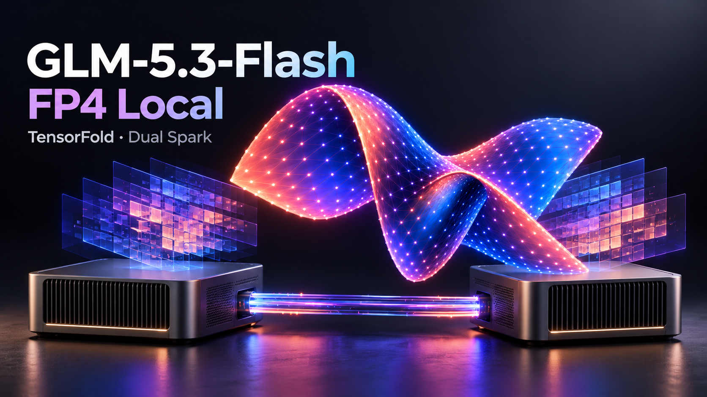

# GLM-5.3-Flash-FP4-Local · TensorFold · Dual Spark



[`nvidia/GLM-5.3-Flash-FP4-Local`](https://huggingface.co/nvidia/GLM-5.3-Flash-FP4-Local) on two 128 GB GB10 Sparks. TP2 over RoCE, patched Python TensorFold 0.6.0, DFlash2 and adaptive span drafting. Target weights and precision are unchanged.

## Measurements

Synthetic record rewrite, thinking off, **512 output tokens**, measured 2026-10-17. Decode excludes prefill and TTFT. C8 is aggregate.

| Requests | Neural drafts only | Adaptive drafts | Gain |
|---:|---:|---:|---:|
| 1 | 84.4 | **116.0** | 37.5% |
| 8 | 291.0 | **396.5** | 36.2% |

Tokens/s, same process and prompts; output hashes matched. [Raw paired measurements](results/2026-10-17-draft-tests/paired-validation.json).

Separate **128-token**, isolated C8 confirmation bursts reached 339–342 tok/s, versus 213 with the original serving profile. General prose/code screens reached 140/152 tok/s at C8, versus 110/132 previously. Gains depend on workload and output length. [Comparisons and scope](results/2026-10-17-draft-tests/README.md).

[Fresh C1–C8 thinking off/high decode and cold-prefill table](results/2026-10-17-adaptive/README.md). Best cold prefill in that sweep: **896 input tok/s**.

FP8 KV pool: **1,286,144 shared tokens**, eight slots; **262,144-token** per-request limit. Wider verification uses more buffer memory. [Configuration and cache tradeoff](docs/performance-tuning.md).

## Run

```bash
docker build -t local/glm53-fp4-local-tensorfold:20261017-v3 .
```

[Download and start both ranks](docs/setup.md). [Adaptive drafting and API control](docs/adaptive-drafting.md).

```bash
python3 benchmarks/run.py --workload edit --input-lines 32 --output-tokens 128 --out local-results/sweep
python3 benchmarks/report.py local-results/sweep
```

The target snapshot is 165.3 GiB. [Pinned revisions](provenance.json). The measured drafter is **CC BY-NC-ND 4.0**; the target uses the NVIDIA Open Model Agreement. Weights are downloaded separately.

## Credits

[TensorFold](https://github.com/ashhart/TensorFold) engine and CUDA kernels; [MiaAI-Lab](https://github.com/MiaAI-Lab/GLM-5.3-Flash-EXL3-2x-DGX-Sparks-TensorFold) Spark base and backports; [FlashInfer/b12x](https://github.com/flashinfer-ai/flashinfer/tree/main/flashinfer/experimental/b12x) scale format and RoCE lineage. Models from NVIDIA, Z.AI and IncoAI. [Full credits](third_party/MiaAI-CREDITS.md) · [Notices](NOTICE).
